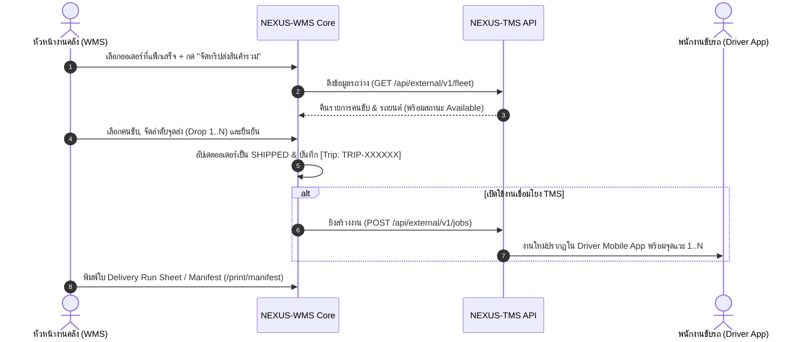
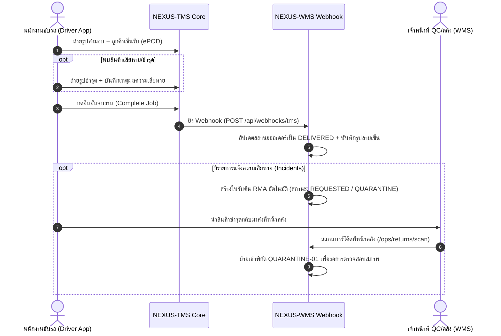
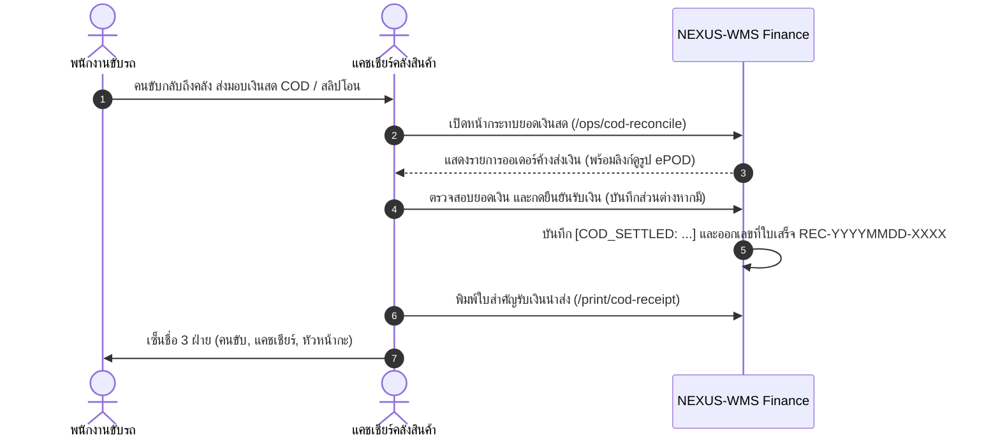

# คู่มือสถาปัตยกรรมและการเชื่อมต่อระบบ NEXUS WMS & TMS
**NEXUS Supply Chain Architecture: Standalone & Connected Enterprise Specification**

---

## 1. ปรัชญาและหลักการออกแบบระบบ (Core Architectural Mandate)

ระบบ **NEXUS-WMS** (Warehouse Management) และ **NEXUS-TMS** (Transportation Management) ถูกออกแบบภายใต้หลักการ **"Loosely Coupled, Highly Cohesive"**:

1. **โหมดทำงานแยกอิสระ 100% (Standalone Mode)**:
   - ลูกค้าบางรายอาจจัดซื้อหรือเช่าใช้บริการเพียงระบบใดระบบหนึ่ง
   - WMS ต้องทำงานได้ครบวงจร (รับ, จัดเก็บ, หยิบ, แพ็ก, กระทบยอดเงินสด COD, รับสินค้าคืนเข้า Quarantine) โดยไม่ต้องพึ่งพา TMS
   - TMS ต้องทำงานได้ครบวงจร (วางแผนเที่ยวรถ, จ่ายงานให้คนขับ, Mobile ePOD, วางบิล) โดยไม่ต้องมี WMS
2. **โหมดทำงานเชื่อมโยงกัน (Connected Mode)**:
   - เมื่อเปิดใช้งานร่วมกัน ทั้งสองระบบจะซิงค์ข้อมูลผ่าน REST API และ Webhooks อัตโนมัติ
   - มีระบบ Circuit Breaker และ Fault-Isolation: หากระบบใดล่มหรือเน็ตเวิร์กหน่วง จะไม่ทำให้กระบวนการหลักของอีกระบบหยุดชะงัก (Graceful Degradation)

---

## 2. เมทริกซ์การเปรียบเทียบฟังก์ชัน (Standalone vs Connected)

| ฟังก์ชันการทำงาน | เมื่อใช้งาน WMS แบบ Standalone | เมื่อเปิดใช้งานเชื่อมโยง WMS + TMS |
| :--- | :--- | :--- |
| **การจัดทริปส่งสินค้ารวม (Multi-Drop Trip)** | จัดคิวส่งหลายออเดอร์ในหน้า `/ops/orders` และพิมพ์ใบกำกับ **Delivery Manifest** (`/print/manifest`) ได้ทันที | รวมออเดอร์เป็น 1 Job ใน TMS อัตโนมัติ พร้อมส่งเข้าแอปคนขับเรียงตาม Drop Sequence |
| **การเลือกรถและคนขับ (Fleet Selection)** | ดึงรายชื่อรถ/คนขับจากตารางภายใน WMS (`fleet_vehicles`) หรือพิมพ์ระบุเอง | ซิงค์คนขับและรถยนต์จาก TMS API (`/api/external/v1/fleet`) พร้อมสถานะ "ว่าง" หรือ "กำลังวิ่งงาน" |
| **การส่งมอบ & หลักฐาน ePOD** | คลังอัปเดตสถานะออเดอร์เป็น SHIPPED/DELIVERED หรือแนบรูปลายเซ็นใน WMS ได้เอง | คนขับบันทึกลายเซ็นและรูปถ่ายสินค้าผ่านแอป TMS แล้วระบบยิง Webhook มาปิดออเดอร์ใน WMS อัตโนมัติ |
| **สินค้าเสียหาย / ตีกลับ (Reverse Logistics)** | ยิงสแกนรับของคืนที่ Dock หน้าคลัง (`/ops/returns/scan`) เข้าพิกัด `QUARANTINE-01` | เมื่อคนขับแจ้งของชำรุดใน TMS ePOD ระบบ WMS จะเปิดตั๋ว RMA รอกักกันอัตโนมัติพร้อมแนบรูปจากที่เกิดเหตุ |
| **กระทบยอดเงินสด COD & ค่าขนส่ง** | แคชเชียร์คลังตรวจนับเงินสด/สแกน QR ผ่านหน้า `/ops/cod-reconcile` และพิมพ์ใบสำคัญรับเงิน (`/print/cod-receipt`) | แคชเชียร์สามารถกดเปิดดูภาพถ่ายและลายเซ็น ePOD ของคนขับจากหน้างานก่อนกดยืนยันรับเงินเข้าคลัง |

---

## 3. ผังการทำงาน (Data Flow & Sequence Diagrams)

### 3.1 การจัดทริปส่งสินค้ารวม (Multi-Drop Dispatch)


### 3.2 การส่งมอบสินค้า และการแจ้งความเสียหาย (ePOD & Incident Flow)


### 3.3 การกระทบยอดเงินสด COD และออกใบสำคัญรับเงิน (Financial Settlement)


---

## 4. การตั้งค่า Environment Variables

### ฝั่ง NEXUS-WMS (`.env.local` หรือ Vercel Environment)
```bash
# ปิด/เปิด การเชื่อมโยง TMS (true = ปิดใช้ WMS แบบ Standalone, false/เว้นว่าง = เปิด)
TMS_DISABLED=false

# URL และ API Key สำหรับเรียก TMS
TMS_API_URL=https://nexus-tms-six.vercel.app/api/external/v1/jobs
TMS_API_KEY=wms_29d785e94f0943c5518f129f210768459d018af20f9e0d2a

# Secret สำหรับตรวจสอบสิทธิ์ Webhook ที่ TMS ยิงกลับมาหา WMS
TMS_WEBHOOK_SECRET=nexus_wms_tms_secret_2026

# รหัสสาขาเริ่มต้น
TMS_BRANCH_ID=URT
```

### ฝั่ง NEXUS-TMS (`.env.local` หรือ Vercel Environment)
```bash
# Webhook URL ของ WMS สำหรับรับแจ้งสถานะงานส่งมอบและ POD
WMS_WEBHOOK_URL=https://nexus-wms-phi.vercel.app/api/webhooks/tms
WMS_WEBHOOK_SECRET=nexus_wms_tms_secret_2026
```

---

## 5. คู่มือขั้นตอนการปฏิบัติงานมาตรฐาน (SOP Checklist)

### ก. สำหรับหัวหน้างานคลัง (Warehouse Dispatcher)
1. เข้าเมนู **ออเดอร์ขาออก (Sales Orders)** (`/ops/orders`)
2. เลือกออเดอร์ที่มีสถานะ `PACKED` (แพ็กกล่องเสร็จแล้ว)
3. ติ๊กเลือกหลายออเดอร์ที่ต้องการจัดส่งไปในเส้นทางเดียวกัน
4. กดปุ่ม **"จัดทริปส่งรวม (Multi-Drop Trip)"** ที่แถบด้านล่าง
5. เลือกรถและคนขับจาก Dropdown (ระบบจะดึงรถที่ว่างจาก TMS ให้อัตโนมัติ)
6. จัดเรียงลำดับจุดแวะ (Drop #1, #2, #3) ตามความเหมาะสมของเส้นทาง
7. กดยืนยัน ➔ กดปุ่ม **"พิมพ์ใบกำกับสินค้าส่งมอบ (Delivery Manifest)"** เพื่อมอบให้คนขับ

### ข. สำหรับพนักงานขับรถ (Delivery Driver)
1. ตรวจนับกล่องและสินค้าตามใบกำกับ Delivery Manifest ก่อนนำขึ้นรถ
2. เมื่อถึงจุดส่งแต่ละจุด ให้เปิดงานใน Driver Mobile App
3. ให้ลูกค้าตรวจสอบสินค้า และลงลายมือชื่อบนหน้าจอโทรศัพท์
4. ถ่ายรูปสถานที่และตัวสินค้าเป็นหลักฐาน (ePOD)
5. หากพบสินค้าแตกหัก ชำรุด หรือลูกค้าปฏิเสธรับ ให้กดเมนู **แจ้งความเสียหาย (Damage Report)** พร้อมถ่ายรูปสินค้าที่มีตำหนิ
6. เรียกเก็บเงินสด COD (ถ้ามี) และกดยืนยันจบงาน (Complete Drop)

### ค. สำหรับเจ้าหน้าที่ตรวจรับสินค้าคืน (Returns & QC Inspector)
1. เมื่อคนขับนำสินค้าชำรุดกลับมาถึงคลัง ให้เปิดหน้า **สแกนรับสินค้าคืน** (`/ops/returns/scan`)
2. ใช้เครื่อง PDA หรือกล้องสแกนบาร์โค้ดใบปะหน้า หรือเลขที่ออเดอร์
3. ระบบจะแสดงข้อมูลสินค้าชำรุดที่คนขับเคยแจ้งไว้จากหน้างานทันที
4. ตรวจสอบสภาพจริง และกดปุ่ม **"รับเข้าพิกัดกักกัน (QUARANTINE-01)"** เพื่อรอการเคลมหรือคัดแยกต่อไป

### ง. สำหรับแคชเชียร์และฝ่ายการเงิน (Warehouse Cashier & Finance)
1. เมื่อคนขับเสร็จสิ้นการวิ่งทริป ให้เข้าเมนู **กระทบยอดเงินสด COD & ค่าขนส่ง** (`/ops/cod-reconcile`)
2. ตรวจสอบรายการออเดอร์ของคนขับรายนั้นว่ามียอดเก็บเงินปลายทางเท่าใด
3. สามารถกดดูรูปถ่ายและลายเซ็นยืนยันการส่งมอบ (ePOD Proof) ได้ทันที
4. ตรวจนับเงินสดหรือสแกนยอดเงินโอน หากยอดเงินตรงกัน ให้กดปุ่ม **"รับเงินนำส่ง"**
5. หากมียอดขาด ให้ระบุเหตุผลส่วนต่างในช่องที่กำหนด
6. ระบบจะสร้างเลขที่ใบสำคัญรับเงินอัตโนมัติ (เช่น `REC-20261029-XXXX`)
7. กด **"พิมพ์ใบสำคัญรับเงิน"** (`/print/cod-receipt`) ให้คนขับและแคชเชียร์ลงนามเก็บไว้เป็นหลักฐาน
